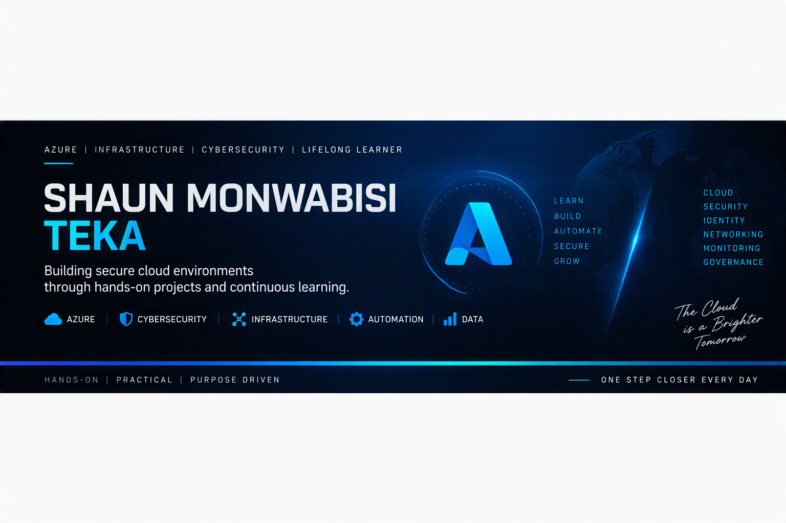

  

 

  

 
---

## 👨🏽‍💻 About Me

I am an IT and Cybersecurity professional with experience across Cloud Infrastructure, Security Operations, Systems Administration, and Enterprise Infrastructure Support.

I am passionate about designing, securing, and managing modern cloud environments while continuously building practical cybersecurity expertise through hands-on labs, threat hunting, and real-world security simulations. My focus includes leveraging Microsoft cloud and security technologies to strengthen security posture, improve resilience, and support secure infrastructure operations.

---

## 🎯 Core Focus Areas

- Security Operations Center (SOC)
- Threat Hunting & Detection Engineering
- Microsoft Sentinel (SIEM)
- Microsoft Defender XDR
- Azure Security & Cloud Protection
- Identity & Access Management (IAM)
- Incident Detection & Response

---

## 🚀 Featured Projects

- 🔵[Microsoft Sentinel Threat Hunting & Command-and-Control Detection Lab](https://github.com/ShaunTeka/soc-analyst-lab)
- 🛡️ [Microsoft Defender for Endpoint Lab](https://github.com/ShaunTeka/soc-analyst-lab/tree/main/microsoft-defender-endpoint-lab)
- 🏢 [Active Directory Security Lab](https://github.com/ShaunTeka/active-directory-lab)
- ☁️ [Azure Security Lab](https://github.com/ShaunTeka/cybersecurity-portfolio-)
- 🔍 [SOC Analyst Detection & Investigation Lab](https://github.com/ShaunTeka/cybersecurity-portfolio)

---

## 🛠️ Tools & Technologies

**Security**
- Microsoft Sentinel
- Microsoft Defender XDR
- Microsoft Defender for Endpoint
- Microsoft Entra ID

**Cloud & Infrastructure**
- Microsoft Azure
- Azure Arc
- Windows Server
- Virtual Machines

**Security Operations**
- Kusto Query Language (KQL)
- MITRE ATT&CK Framework
- Log Analysis
- Threat Hunting
- Incident Investigation

---

## 🎓 Education

- BSc Information Technology
- BSc Honours Information Technology
- BCom Law

---

## 📜 Certifications

- [Microsoft Certified: Azure Fundementals (AZ-900) *(Passed)*](https://learn.microsoft.com/en-us/users/ShaunMonwabisiTeka/credentials/43AC9A17FCE7992B?ref=https%3a%2f%2fwww.linkedin.com%2f)
- [Microsoft Certified: Azure Artificial Fundamentals (AZ-901) *(Passed)*](https://learn.microsoft.com/en-us/users/ShaunMonwabisiTeka/credentials/3F151AB6A62159B0?ref=https%3a%2f%2fwww.linkedin.com%2f)
- [Microsoft Certified: Azure Administrator Associate (AZ-104) *(Passed)*](https://learn.microsoft.com/en-us/users/shaunmonwabisiteka/credentials/2eaca8f4a6714847?ref=https%3A%2F%2Fwww.linkedin.com%2F)
- [Microsoft Certified: Azure Solutions Architect Expert (AZ-305) *(Passed)*](https://learn.microsoft.com/en-us/users/shaunmonwabisiteka/training?ref=https%3A%2F%2Fwww.linkedin.com%2F&source=docs)
- [Microsoft Certified: Azure DevOps Engineer Expert (AZ-400) *(Passed)*](https://learn.microsoft.com/en-us/users/shaunmonwabisiteka/training?ref=https%3A%2F%2Fwww.linkedin.com%2F&source=docs)

---

## 📫 Connect With Me

- LinkedIn: https://www.linkedin.com/in/shaunmonwabisiteka
- Email: shaunmonwabisiteka@gmail.com

---

> “Building real-world cloud, infrastructure and cybersecurity skills through hands-on experience, continuous learning, and practical operations exposure.”

